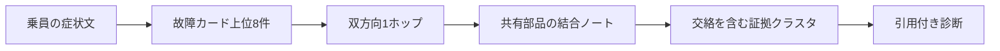

# 宇宙船故障診断RAG

アルケオン型探査艦で、乗員の曖昧な報告から故障のつながりを組み立てる RAG です。

> 最近ワープ直後だけ機体の右側が熱くなる。燃費も悪化した。

乗員は「ワープ」「燃費」「右側」と話しますが、整備文書は「ジャンプ復帰」「反物質消費」「右舷」と記録します。さらに、症状の結論はどの文書にも単独では書かれていません。部分一致する複数の故障カードと、部品の接続だけを記した結合ノートを検索時に束ね、診断は生成時にだけ作ります。

世界設定の詳細ではなく、動かし方を先に知りたい場合は [起動方法](#起動方法) へ進んでください。

## なぜRAGなのか

このプロジェクトは、宇宙船を題材にした全文検索アプリではありません。物語上の制約が、そのまま検索の技術要件になっています。

- 埋め込みは、乗員語と整備語の言い換えを吸収します。
- ベクトル検索は、症状の一部に対応する故障カードを上位8件まで残します。
- 部品グラフは `derived` を双方向に1ホップ辿り、種どうしを結ぶ経路を補います。
- 結合ノートは、展開後に共有部品が2個以上そろった場合だけ追加します。クエリとの類似度では取得しません。
- 交絡カードは検索時には捨てず、報告にない識別症状を使って生成時に棄却します。
- LLM は、最低2枚の故障カードと1枚の結合ノートを引用して診断します。

カードや結合ノートにあらかじめ答えを書かないため、埋め込み、グラフ展開、生成のどれか一つを外すと複合症状の説明が閉じません。

## 診断の流れ



Chroma で類似検索するのは故障カード100件です。結合ノート24件はベクトル種にせず、YAML の `links` とカードの `components` を使って Python 側で取得します。

## Q01で起きること
```text
Q01: 最近ワープ直後だけ機体の右側が熱くなる。燃費も悪化した。
```

デモ入力 Q01 は、次の文書に分かれた事実を必要とします。

- `FLT-017` — ジャンプ復帰後の短い時間だけ、右舷折畳みコイルの残熱が出る。
- `FLT-044` — 大きな熱入力のあと、右舷暗黒熱弁が固着して二つの熱経路を滞らせる。
- `FLT-028` — 対消滅室の左右温度差により、噴射格子が反物質流量を増やす。
- `CPL-03` — コイル残熱と対消滅室右舷ジャケットの帰路が、同じ右舷弁で合流する。

### 関門の実測結果

`bge-m3` で `FLT-017` は100件中1位でした。上位8件には `FLT-017`、`FLT-044`、`FLT-028` が入り、拡張後のクラスタには `CPL-03` があります。

- `CPL-03` はベクトル検索の種ではなく、共有部品から追加されています。
- `FLT-028` の下流にある `FLT-073` は、種どうしを結ぶ経路ではないためクラスタに残りません。
- 上位8件に入った交絡カードは `FLT-061` と `FLT-052` だけです。
- `FLT-008` は13位なので、IDを指定してクラスタへ足していません。

同じ入力に対する全文検索では `CPL-03` のスコアは0です。RAGでは最終的に `CPL-03` の接続を提示できますが、全文検索だけでは取得できません。

この差が、この題材で RAG を使う理由です。

## 技術スタック

- Python 3.12
- Ollama
  - 埋め込み: `bge-m3`
  - 生成: `qwen3:4b`
  - ローカルに `qwen3:8b` があれば、そちらを優先
- Chroma — 故障カードの永続ベクトルインデックス
- Streamlit — 症状入力、検索過程、引用付き診断の表示
- YAML — 故障カード、結合ノート、評価ゴールド

Ollama とは HTTP API で通信します。Python の `ollama` パッケージは使用しません。

## 起動方法

### 1. Python環境を作る

```bash
python3 -m venv .venv
.venv/bin/pip install -r requirements.txt
```

### 2. Ollamaを起動する

Compose は Ollama だけを起動し、名前付きボリュームへ `bge-m3` と `qwen3:4b` を保存します。モデルファイルは Git に入りません。

```bash
docker compose up -d
docker compose logs -f ollama
```

初回は両モデルの取得完了まで待ち、ログの追跡は `Ctrl-C` で終了します。Ollama 自体はバックグラウンドで動き続けます。

既存のローカル Ollama を使う場合は、Compose の代わりに次を実行します。

```bash
ollama serve
ollama pull bge-m3
ollama pull qwen3:4b
```

別ホストの Ollama を使う場合は、以降のコマンドへ `OLLAMA_HOST=http://host:11434` を設定してください。

### 3. 画面を起動する

```bash
.venv/bin/streamlit run app.py
```

表示された URL を開き、Q01 を入力します。

```text
最近ワープ直後だけ機体の右側が熱くなる。燃費も悪化した。
```

画面は、通常のベクトル種、交絡候補、経路で追加したカード、結合ノート、診断文を分けて表示します。

停止するときは次を実行します。

```bash
docker compose down
```

名前付きボリュームは残るため、次回はモデルを再取得しません。モデルも削除する場合だけ `docker compose down -v` を使います。

## 検証

### コーパスと単体テスト

```bash
.venv/bin/python -m unittest discover -s tests
```

故障カード100件、結合ノート24件、役割と系統の配分、禁止語、参照先、予約本文などを検査します。

完成コーパスのバリデータだけを実行する場合:

```bash
.venv/bin/python - <<'PY'
from pathlib import Path
from shipdiag.validate import load_corpus, validate_corpus

faults, couplings = load_corpus(Path("data"))
issues = validate_corpus(faults, couplings, complete=True)
print("\n".join(issues) if issues else "OK")
raise SystemExit(bool(issues))
PY
```

### 埋め込みの関門

```bash
.venv/bin/python -m shipdiag.gate
```

100件の故障カードに対して Q01 を検索し、`FLT-017` が上位8件に入ることを確認します。合格したモデル名は `embedding_model.txt` に保存されます。

### composeクエリの評価

```bash
.venv/bin/python -m shipdiag.eval_compose
```

15件の複合症状について、必須IDのクラスタ再現率と同じクエリの全文検索を比較します。Q01 ではクラスタ再現率1.00、全文検索再現率0.00で、`CPL-03` の全文検索スコアが0であることも検査します。

`bge-m3` での実測結果:

| ID | クラスタ再現率 | 全文検索再現率 | 差 |
| --- | ---: | ---: | ---: |
| Q01 | 1.00 | 0.00 | +1.00 |
| Q02 | 1.00 | 0.25 | +0.75 |
| Q03 | 1.00 | 0.00 | +1.00 |
| Q04 | 0.67 | 0.67 | 0.00 |
| Q05 | 0.33 | 0.00 | +0.33 |
| Q06 | 1.00 | 1.00 | 0.00 |
| Q07 | 1.00 | 0.67 | +0.33 |
| Q08 | 0.67 | 0.33 | +0.33 |
| Q10 | 1.00 | 0.00 | +1.00 |
| Q12 | 0.33 | 0.00 | +0.33 |
| Q15 | 1.00 | 1.00 | 0.00 |
| Q16 | 0.75 | 0.00 | +0.75 |
| Q17 | 1.00 | 0.50 | +0.50 |
| Q19 | 0.83 | 0.50 | +0.33 |
| Q20 | 1.00 | 0.00 | +1.00 |

Q01 の `CPL-03` は、全文検索スコアが0のままです。表の「差」は、クラスタ再現率から全文検索再現率を引いた値です。

評価対象は診断文の文字列一致ではありません。同じ根拠から表現の異なる診断文が生成されても、必要な故障カードと結合ノートを再現できているかを採点します。

## リポジトリ構成

- `app.py` — Streamlit 画面
- `shipdiag/` — インデックス、Retriever、全文検索対照、プロンプト、Ollama 通信、評価
- `data/faults/` — 故障カード100件
- `data/couplings/` — 結合ノート24件
- `data/eval/` — composeクエリの評価ゴールド
- `tests/` — バリデータ、検索、Retriever、評価データのテスト
- `docs/` — 世界設定と設計仕様

## 設計資料

仕様の正本は [`docs/README.md`](docs/README.md) から順に読めます。

1. [技術体系](docs/01-technology.md)
2. [故障カードの設計規則](docs/02-card-rules.md)
3. [乗員症状50件](docs/03-symptom-queries.md)
4. [検索仕様](docs/04-retrieval.md)
5. [Q01のデモ診断](docs/05-demo-diagnosis.md)
