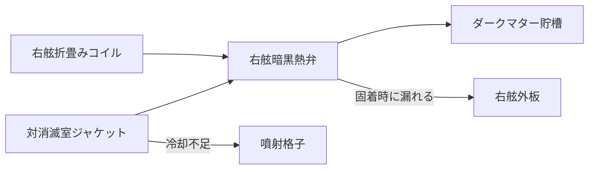

# 技術体系

対象艦はアルケオン型探査艦。空間を折って短いジャンプを行う。折り畳みコイルの廃熱と、反物質対消滅室の廃熱は、同じ暗黒熱バスへ捨てる。この共有が、無関係に見える症状を一つの故障へ結ぶ。

関連: [カード規則](02-card-rules.md) / [検索仕様](04-retrieval.md) / [デモ診断](05-demo-diagnosis.md)

## 熱と推進のつながり

右舷弁は、右舷折畳みコイルの残熱配管と、対消滅室右舷ジャケットの帰路を同一弁体で合流させる。左舷弁は別回路で、この合流を持たない。

## 固定する物理制約

カードと結合ノートを書くとき、次の4つ以外の物理を足さない。

1. 廃熱の唯一の正規出口は暗黒熱バスである。
2. 右舷弁は、右舷コイル残熱と対消滅室右舷ジャケットの共有点である。左舷弁は別回路である。
3. 対消滅室の左右温度差がおよそ15Kを超えると、噴射格子は反物質を増やして燃焼を対称に戻す。反物質の使用量は増える。
4. ジャンプ残熱パルスは右舷に偏り、通常空間へ戻ったあと90〜180秒で収まる。弁の熱固着も、弁体が熱いうちだけ続く。

## 系統と部品ID

`systems` と `components` は、ここにあるIDだけを使う。1枚のカードの主系統は1つ。部品は1〜3個。

### 対消滅推進系 `annihilation`（カード14枚）

乗員の「燃費」は反物質の使用量、「エンジン」は対消滅室を指す。

| 部品ID | 名称 |
| --- | --- |
| `antimatter_bottle` | 反物質磁気瓶 |
| `port_injector` | 左舷噴射格子 |
| `starboard_injector` | 右舷噴射格子 |
| `annihilation_chamber` | 対消滅室 |
| `annihilation_jacket` | 対消滅室右舷ジャケット |
| `photon_nozzle` | 光子ノズル |

### 折畳み航法系 `fold`（カード12枚）

乗員はジャンプをワープと呼ぶ。右舷主コイルが主負荷、左舷コイルはトリム。復帰直後の90〜180秒だけ右舷コイルが残熱を出す。バスが健全なら、乗員は船体の熱として感じない。

| 部品ID | 名称 |
| --- | --- |
| `starboard_fold_coil` | 右舷折畳みコイル |
| `port_fold_coil` | 左舷トリムコイル |
| `mass_shadow_compensator` | 質量影補償器 |

質量影補償器は重力制御系と共有する。

### 暗黒熱バス `dark_thermal`（カード10枚）

折畳みコイル、対消滅室、生命維持、シールドの廃熱がここへ集まる。

| 部品ID | 名称 |
| --- | --- |
| `dark_thermal_bus` | 暗黒熱バス |
| `starboard_dark_valve` | 右舷暗黒熱弁 |
| `port_dark_valve` | 左舷暗黒熱弁 |
| `dark_matter_reservoir` | ダークマター貯槽 |
| `thermal_check_valve` | 逆止弁 |

### 重力制御系 `gravity`（カード10枚）

故障は体が一方へ引かれる現象であり、外板温度でも反物質消費でもない。

| 部品ID | 名称 |
| --- | --- |
| `starboard_damper` | 右舷慣性ダンパー |
| `port_damper` | 左舷慣性ダンパー |
| `gravity_deck` | 擬似重力甲板 |

### 量子通信系 `comms`（カード10枚）

対消滅放射線と、ジャンプ復帰時の残渣位相で、デコヒーレンス遮蔽が落ちる。通信の症状だけでは原因の系統が閉じない。

| 部品ID | 名称 |
| --- | --- |
| `entanglement_bank` | もつれ対バンク |
| `phase_lock_array` | 位相ロックアレイ |
| `decoherence_shield` | デコヒーレンス遮蔽 |

### 零点抽出電力系 `power`（カード8枚）

電圧低下は、消費の増加、冷却の低下、通信の劣化を同時に模倣する。症状は電圧が落ちているあいだ続き、ジャンプ直後の数分には限定されない。

| 部品ID | 名称 |
| --- | --- |
| `zpe_bus` | 零点母線 |
| `starboard_power_leg` | 右舷給電レグ |

### 恒星風シールド `shield`（カード8枚）

右舷エミッタの粒子加熱で右舷外板温度が上がる。相関は対気速度とシールド展開であり、ジャンプ復帰ではない。

| 部品ID | 名称 |
| --- | --- |
| `starboard_shield_emitter` | 右舷シールドエミッタ |
| `port_shield_emitter` | 左舷シールドエミッタ |

### 生命維持 `life_support`（カード8枚）

居住区ダクトの熱は外板温度と別経路である。部屋の中だけが暑い、という報告の受け皿になる。

| 部品ID | 名称 |
| --- | --- |
| `starboard_habitat_duct` | 右舷居住区ダクト |
| `port_habitat_duct` | 左舷居住区ダクト |
| `atmosphere_loop` | 大気循環 |

### 位相計器 `sensors`（カード10枚）

表示と実測が一致しない故障を置く。センサーが熱いと言い、手袋越しの船体は冷たい、という報告の受け皿になる。

| 部品ID | 名称 |
| --- | --- |
| `hull_temp_sensor` | 外板温度センサー |
| `consumption_sensor` | 反物質消費センサー |
| `phase_sensor` | 位相センサー |

### 船体 `hull`（カード10枚）

| 部品ID | 名称 |
| --- | --- |
| `starboard_hull` | 右舷外板 |
| `port_hull` | 左舷外板 |
| `hull_integrity_field` | 構造健全性フィールド |

配分の合計は 14+12+10+10+10+8+8+8+10+10 = 100 である。
