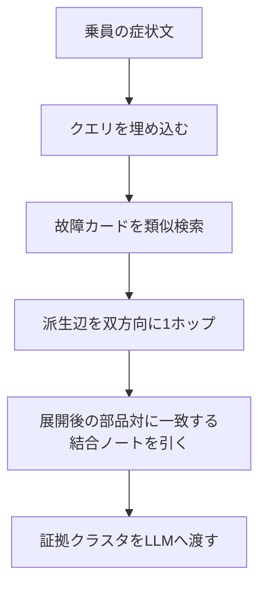

# 検索仕様

Retriever は、順位の1位を診断にしません。互いに不足した文書の集合を組み、結論の書いていないコンテキストを生成へ渡します。

関連: [カード規則](02-card-rules.md) / [症状50件](03-symptom-queries.md) / [デモ診断](05-demo-diagnosis.md)

## 全文検索が取りこぼすもの

比較に使うクエリは Q01 です。

> 最近ワープ直後だけ機体の右側が熱くなる。燃費も悪化した。

対応する事実は別々の文書に分かれます。

- FLT-017 は、通常空間へ戻った直後に右舷外板温度が上がることだけを述べる。
- FLT-028 は、対消滅室の左右温度差で反物質の使用量が増えることだけを述べる。
- FLT-044 は、右舷弁が大熱入力のあと固着し、廃熱が外板へ漏れ、ジャケットの熱引きが落ちることだけを述べる。
- CPL-03 は、その弁がコイル残熱とジャケット帰路の合流点であることだけを述べる。

全文検索がこの分離で失敗する点は次のとおりです。

- 識別語が一致しない。`燃費` と `ワープ` は文書に存在しない。一致しやすい `熱` と `右` は多数のカードにあり、BM25 は識別できない。
- AND 検索はゼロ件になる。1枚の文書が、時間窓、右舷の熱、消費の増加、弁の合流を同時に持たない、とバリデータが保証する。
- OR 検索は、熱に関するカードのリストと、消費に関するカードのリストを並べる。同一の弁だとは結び直さない。
- 同義語辞書を足しても、構造文書には届かない。`燃費→消費`、`ワープ→ジャンプ`、`右側→右舷` まで展開できても、CPL-03 は弁の接続しか書かない。クエリ語とも、その同義語とも、重ならない。
- 「直後だけ」は時間制約である。必須語にすると該当が消え、無視すると定常過熱のカードが同じ順位帯に残る。
- 否定を扱えない。Q36「熱くはない。引っ張られる」は牽引が本命だが、`熱` を含むクエリとして熱カードが上に来る。

埋め込みが受け持つのは言い換えです。熱くなるは外板温度が上がることに、燃費は反物質の使用量に、右側は右舷に寄せます。結合そのものは埋め込みだけでは閉じません。CPL-03 はクエリと似ていません。そこへは部品グラフで到達します。

第1週の関門: Q01 で `bge-m3` が FLT-017 を上位8件に入れるかを見る。入らなければ `qwen3-embedding:4b` に替える。それでも入らなければ、FLT-017 の症状文を「超光速の航法を終えて通常空間へ戻った直後」へさらに寄せる。トークン `ワープ` はカードへ足しません。

## Retriever

コレクションは二つです。

- `fault_cards` — 故障カード100件。クエリとの類似検索の対象。
- `coupling_notes` — 結合ノート24件。類似検索の種にしない。

埋め込む故障カードのテキストは、`name`、`symptoms`、`cause`、部品の日本語名を連結したものです。結合ノートは投入しておいてよいですが、Q01 の種検索からは引きません。

### 手順

1. クエリを1本のベクトルにする。
2. `fault_cards` から上位8件を種にする。1位だけで採用しない。前半にしか似ていないカードと、後半にしか似ていないカードを両方残す。
3. 種の `derived` を、原因方向と結果方向の両方へ1ホップ辿る。
4. ホップ結果は、種どうしを結ぶ経路に乗っているものを優先する。経路の端からさらに先の下流は、プロンプトへ足さない。これで、端カードの下流を完成コーパスで1件足しても、デモの証拠集合が膨らみません。
5. 種と採用したホップの `components` を集める。`links` がその集合に2個以上含まれる結合ノートを引く。CPL-03 は、`starboard_fold_coil` と `annihilation_jacket` と `starboard_dark_valve` が揃ったときに入る。類似度が低くても落とさない。
6. ベクトルで入った交絡は残す。検索段階で捨てない。
7. 渡すのは、観測、機構、接続、`discriminators` だけです。答えの文章は渡しません。

合格条件の一つ: CPL-03 は拡張前の類似上位に無く、拡張後のクラスタにはある。

### 生成契約

プロンプトは次の順を要求します。

1. 部分一致。どのカードがクエリのどの部分に対応するか。
2. 共有部品。どの接続が、分かれた観測を一つの時間窓へ載せるか。
3. 報告されていない識別症状。`discriminators` にあって、クエリに無いもの。
4. 棄却。交絡を本命にしない理由。
5. 確認計測。

制約:

- 単一カードを診断にしない。
- 故障カードを最低2枚、結合ノートを最低1枚、引用する。
- `single` クエリで結合が不要なときは、その旨を書いてから1枚を主にしてよい。`compose` では不可。
- 深刻度は、採用したカードの最大値をそのまま写さない。経路として同時に起きている故障の運用影響で決める。

## MVP

2週間で組む個人開発の構成です。ベクトル庫は Chroma を使います。100件と結合ノート24件にサーバーは不要で、グラフ展開はアプリ側のID参照で足ります。メタデータは、あとから Qdrant のペイロードへ移せます。

- 埋め込み: Ollama `bge-m3`（約1.2GB、1024次元）。第1週の関門を外れたら `qwen3-embedding:4b`
- 生成: Ollama `qwen3:8b`。VRAM が厳しければ `qwen3:4b`
- ベクトル: Chroma 永続化。コレクションは `fault_cards` と `coupling_notes`
- メタデータ: `id` `role` `systems` `components` `severity` `triggers` `derived`。リストは Chroma の制約に合わせて文字列で持ち、展開時にアプリ側で分解してよい
- UI: Streamlit。症状入力、採用クラスタのグラフ（ベクトル種とグラフ追加を分ける）、カードごとの採用理由、引用付き診断、棄却したカード
- 依存: `ollama`、`chromadb`、`streamlit`

評価は [症状50件](03-symptom-queries.md) の `compose` のうち約15件に、ゴールド集合（種、結合ノート、本命にしてはいけない交絡）を付けて行います。見る数は次の三つです。

- ベクトル段階の種再現率
- 拡張後のクラスタ再現率（結合ノートを含む）
- 同じゴールドに対する全文検索ベースラインとの差

正解文との文字列一致は採点しません。

進め方:

- 1〜3日: オントロジーの固定（本仕様）、結合ノート、bridge 20枚、バリデータ
- 4〜6日: 残り80枚、Chroma 投入、Q01 の再現率で埋め込みを確定
- 7〜10日: ベクトル検索、1ホップ展開、結合ノート取得、診断プロンプト
- 11〜14日: Streamlit、全文検索対照、15件のクラスタ評価
